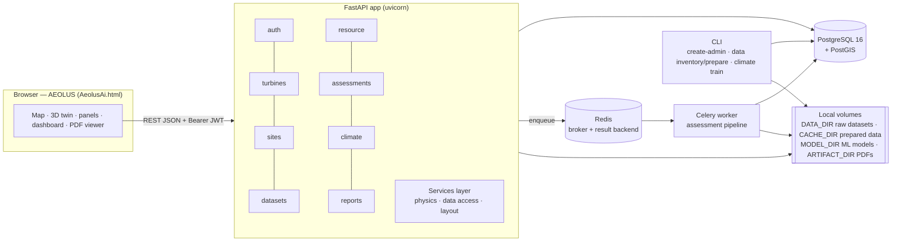
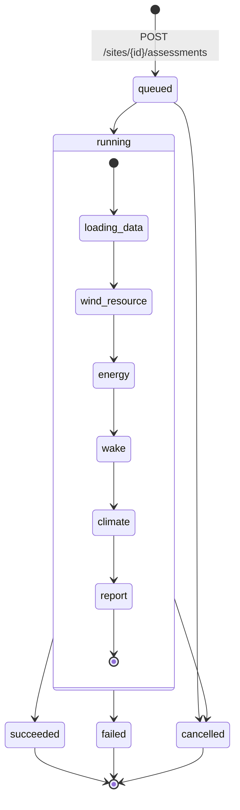
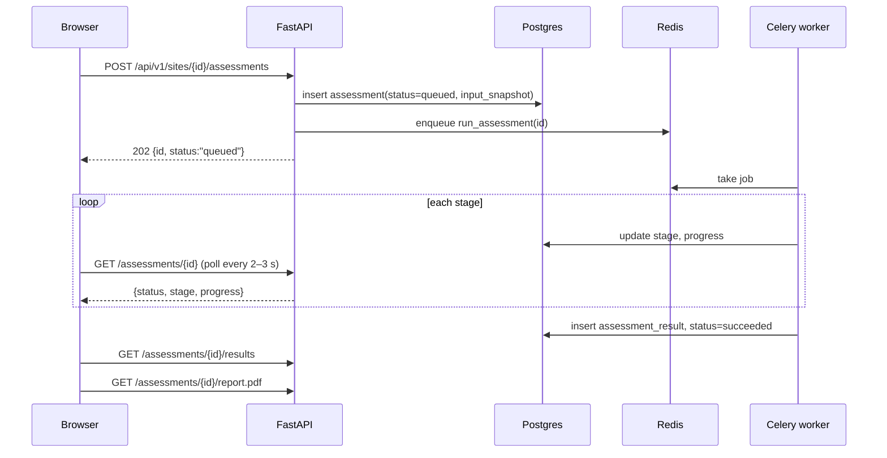

# AEOLUS Backend — System Design & Claude Code Handoff

> Read this whole file before doing anything. It is the single source of truth for the backend.
> Date of design: 2026-11-19 · Owner: Pallab (backend + ML) · Status: design agreed, no code written yet.

---

## 0. How to work with me (instructions for Claude Code)

1. **Work one step at a time** (Section 11). Never start the next step until I say the current one passed my manual test.
2. At the **start of a step**: restate the step's goal and endpoints in a few lines, then build it.
3. At the **end of a step**: stop and give me
   - what was built (files, endpoints, tables),
   - exact manual-test instructions (Swagger `/docs` clicks and/or `.http` requests with expected responses),
   - how to run the automated tests for this step.
4. I am learning. When a concept is new (Alembic migration, Celery task, PostGIS geography, Weibull fit, wake model…), explain it **briefly in plain language and tie it to AEOLUS**. I come from Go/Gin + PostgreSQL, so point out Python/FastAPI idioms that differ.
5. **The frontend (`AeolusAi.html`) is the authority on product behaviour** (field names, limits, formulas, dashboard sections). The original PRD is background only. Where they conflict, follow the frontend and this document.
6. Do not modify the frontend except in **Step 9**, unless I ask.
7. Never commit datasets, `.env`, secrets, generated PDFs or model binaries. Commit only when I ask.
8. Do not invent results. If data or a validated model is missing, the API returns an explicit `not_available` status with a reason — the frontend already displays this.
9. No time/schedule estimates. No unrelated features.

---

## 1. Project summary

**AEOLUS** (repo concept name: WindAI / virtual wind power plant) is a browser-based wind-farm screening tool and 3D digital twin for Bangladesh. The user places circular sites, picks a generic turbine class and count, the browser generates a layout, and the backend produces a **long-term wind-resource and energy assessment** plus a **PDF report**.

- Hobby / beginner research project. Outputs are **screening-level, not bankable**.
- **Single user** (me), secured login, no sign-up.
- **Initial focus area:** Cox's Bazar and the nearby Bay of Bengal. Study region overall: **89–93°E, 15.5–23°N**.
- I already have the datasets (ERA5, GEBCO, ENSO/IOD indices, etc.) locally. They are **not** in the repo. Step 4 starts by inventorying them with me.

### v0.1 scope decisions (agreed)

| Topic | Decision |
|---|---|
| Framework | FastAPI (required) |
| Site geometry | Circle: centre lat/lon + radius (frontend), not polygon |
| Sites | Many sites; one turbine class per site; one assessment = one site |
| Turbines | Generic classes `g36`, `g45`, `g62` (exact values in §6) |
| Layout | Browser generator is the UX; backend ports the same generator, stores positions (incl. manual drags) and computes wakes. Nelder–Mead optimiser **deferred** |
| Wind data | Long-term from local ERA5. The browser's 48 h Open-Meteo forecast stays browser-only |
| Energy horizon | 10-year historical AEP record + P50/P75/P90 |
| ML | ENSO + IOD climate adjustment only, shown only if it beats a baseline on held-out years |
| Finance | **Dropped for v0.1** (no frontend view) |
| PRD forecasting (Informer 6-month, Prophet 10-year), AEP bias correction from thewindpower.net, multi-site comparison, custom turbines, Gaussian wakes, Bayesian placement, SCADA, grid, permitting | **Out of v0.1** |
| Progress updates | Polling (`GET /assessments/{id}`). WebSocket deferred |
| Artifact storage | Local filesystem directory (MinIO/S3 deferred) |

---

## 2. What the frontend is (read `AeolusAi.html`)

Single-file app: MapLibre 2D map + Three.js 3D twin + right-panel analysis + a "Wind site dashboard" dialog with a PDF viewer. Everything currently lives **in browser memory** (refresh = data lost).

**Browser-only today — do NOT treat as backend truth:**
- `store.sites` seeded with 5 study sites in `boot()` (Kutubdia Coast, Bay of Bengal Offshore, Rangpur Plains, Kuakata Coast, Sonagazi Feni).
- Open-Meteo 48 h forecast, "48 h CF", forecast wind rose, prevailing direction.
- Terrain/imagery from AWS Terrain Tiles and Esri; land/water classification from Esri tile colours (no bathymetry).
- The rule-based Assistant.

**Frontend facts the backend must honour:**
- Site object: `{ id, name, lat, lon, radius, count, model, layoutDir, layoutAligned, color, turbines[], layoutInfo }`.
- Turbine object: `{ id: "T01", lat, lon, manual, outside }`.
- Limits: name ≤ 48 chars; lat ±85, lon ±180; radius 500–6000 m step 50; count 1–80; layoutDir 0–359 (direction wind comes **from**).
- `SHEAR = 0.143` fixed in the browser. Backend computes site shear from ERA5 and reports it.
- Dashboard tabs: `overview, resource, direction, turbines, aep, climate, limitations, basis`. The `aep` and `climate` tabs show "Not calculated / Not available" placeholders that the backend fills.
- PDF hook: `resolveReportPdf(site)` uses `site.reportPdfUrl`, `site.reportOutput.pdfUrl`, `site.report.pdfUrl` or `window.AEOLUS_REPORT_PIPELINE.resolvePdfUrl(site)`. It accepts a string URL, `URL`, `Blob` or `Response`. Because the API needs a bearer token, the frontend fetches the PDF with the header and passes a `Response`/`Blob`.
- PDF sidebar indexes sections by searching page text for these strings, so **report headings must contain them**:
  `Site & Wind Resource` · `Wind Direction Analysis` · `Turbine Selection` · `10-Year AEP Analysis` · `ML Climate Adjustment (ENSO + IOD)` · `Limitations & Next Steps`.
- Cox's Bazar sample: a site whose name contains "cox" and "bazar" at **21.4347, 92.0053** loads `AeolusAI_Sample_Report.pdf`. The backend seeds this site; our generated report replaces the sample.

---

## 3. Architecture



**Why each piece exists (plain language)**
- **FastAPI**: HTTP API. Thin routers → services that hold the logic.
- **PostgreSQL + PostGIS**: stores user, sites, turbines, assessments, results. PostGIS adds geography types so "point + radius" and "is this turbine inside the circle" are proper spatial checks.
- **Redis + Celery**: an assessment reads ~10 years of hourly data and runs wake calculations, which is too slow for one HTTP request. The API puts a job on a Redis queue and returns `202` immediately. A separate Celery worker process runs it and writes progress to the DB. The browser polls.
- **Local volumes**: raw datasets (read-only), a prepared fast cache, trained models, generated PDFs.
- **CLI**: admin creation, data preparation and model training are operator tasks, not public endpoints.

### Layering inside the backend

```
router (HTTP, auth, validation)  →  service (business logic)  →  repository (DB) / data store (files)
                                         ↓
                                    physics/ (pure functions, no I/O, unit-tested)
```

---

## 4. Tech stack

| Concern | Choice |
|---|---|
| Language | Python 3.12 |
| Package manager | `uv` (`pyproject.toml`) |
| API | FastAPI, Pydantic v2, pydantic-settings |
| DB | PostgreSQL 16 + PostGIS 3 (Docker image `postgis/postgis`) |
| ORM / migrations | SQLAlchemy 2.0 (sync), GeoAlchemy2, psycopg 3, Alembic |
| Jobs | Celery 5 + Redis 7 |
| Auth | Argon2 password hashing (`argon2-cffi` / `pwdlib`), JWT (`PyJWT`), login rate limit (`slowapi`) |
| Science | numpy, pandas, xarray, netCDF4/h5netcdf, scipy, zarr (or parquet), rasterio, shapely, pyproj |
| ML | scikit-learn, xgboost, joblib |
| Reports | Jinja2 + WeasyPrint, charts as SVG via matplotlib |
| Quality | pytest, httpx TestClient, ruff |
| Run | Docker Compose: `db`, `redis`, `api`, `worker` |

---

## 5. Repository layout

```
aeolus-backend/
├── app/
│   ├── main.py                 # FastAPI app factory, routers, CORS, error handlers
│   ├── core/                   # config.py (settings), security.py, logging.py, errors.py
│   ├── db/                     # session.py, base.py, seed.py
│   ├── models/                 # SQLAlchemy models (user, turbine_class, site, turbine, assessment, dataset)
│   ├── schemas/                # Pydantic request/response models (camelCase JSON)
│   ├── api/
│   │   ├── deps.py             # get_db, get_current_user
│   │   └── routers/            # health, auth, turbines, sites, datasets, resource, assessments, climate, reports
│   ├── services/               # auth_service, site_service, layout_service, data_service, resource_service, ...
│   ├── physics/                # wind.py, shear.py, weibull.py, rose.py, power.py, aep.py, wake.py, pvalues.py
│   ├── data/                   # era5.py, gebco.py, indices.py (readers over CACHE_DIR)
│   ├── ml/                     # climate features, train, evaluate, inference
│   ├── worker/                 # celery_app.py, tasks.py, pipeline.py
│   ├── reports/                # templates/*.html.j2, charts.py, render.py
│   └── cli.py                  # create-admin, data inventory/prepare, climate train
├── alembic/                    # migrations
├── tests/                      # unit (physics) + API tests per domain
├── http/                       # .http request files per domain for manual testing
├── frontend/AeolusAi.html      # reference copy (integration in Step 9)
├── docker-compose.yml
├── Dockerfile
├── .env.example                # no real values
├── pyproject.toml
└── README.md
```

---

## 6. Domain constants (copy exactly from the frontend)

### Turbine classes (`MODELS` in the frontend)

| id | name | D (m) | H hub (m) | rated (kW) | v_in | v_rated | v_out | rpm min–max |
|---|---|---|---|---|---|---|---|---|
| g36 | 3.6 MW class | 120 | 90 | 3600 | 3 | 11.5 | 25 | 5.5–14.9 |
| g45 | 4.5 MW class | 145 | 105 | 4500 | 3 | 11 | 25 | 4.8–12.3 |
| g62 | 6.2 MW class | 170 | 125 | 6200 | 3 | 10.5 | 25 | 4.0–10.6 |

Power curve (must match the frontend's `powerKW`):
```
P(v) = 0                                         if v < v_in or v >= v_out
     = rated                                     if v >= v_rated
     = rated * (v³ − v_in³) / (v_rated³ − v_in³) otherwise
```
Thrust coefficient for the wake model (generic, documented as an assumption): `Ct = 0.8` below rated, then `Ct = 0.8 * (v_rated / v)³` above rated (clamped to ≥ 0.05), 0 outside cut-in/cut-out.

### Layout generator (port `generateLayout` exactly)
Staggered rows aligned to `layoutDir`, keep-out `Rin = max(radius − 0.6·D, 0.5·D)`, spacing factors tried in order `[[4,7],[3.5,6],[3,5],[2.5,4],[2,3],[1.6,2.2]]` (crosswind × downwind, in D). Pick the closest-to-centre points, sort by row, label `T01…`, keep manual turbines and their IDs. `layoutInfo = {spacing, placed, requested, relaxed}`. Local tangent-plane frame as in `Geo.frame`. Python output must equal the JS output for the same inputs (test with fixtures).

### Other constants
- Availability loss 3 %, electrical loss 2 % (assumptions, reported in `method`).
- Seasons for Bangladesh: Winter Dec–Feb, Pre-monsoon Mar–May, Monsoon Jun–Sep, Post-monsoon Oct–Nov.
- Wind rose: 16 sectors, speed bins `<4, 4–8, 8–12, ≥12 m/s` (same as frontend).
- Directions are meteorological: degrees the wind comes **from**, 0 = N, clockwise. `wd = (270 − atan2(v, u)·180/π) mod 360`.
- Units: metres, m/s, kW, MWh, degrees, UTC ISO-8601 timestamps.

---

## 7. Data model

```mermaid
erDiagram
  USER ||--o{ SITE : owns
  TURBINE_CLASS ||--o{ SITE : "used by"
  SITE ||--o{ TURBINE : has
  SITE ||--o{ ASSESSMENT : "assessed by"
  ASSESSMENT ||--o| ASSESSMENT_RESULT : produces
  DATASET }o--o{ ASSESSMENT : "used (recorded in snapshot)"

  USER { uuid id PK; string email UK; string password_hash; bool is_active; timestamptz created_at; timestamptz last_login_at }
  TURBINE_CLASS { string id PK "g36/g45/g62"; string name; int rotor_d_m; int hub_h_m; int rated_kw; float v_in; float v_rated; float v_out; float rpm_min; float rpm_max }
  SITE { uuid id PK; uuid owner_id FK; string name; geography center "Point 4326"; int radius_m; int turbine_count; string turbine_class_id FK; int layout_dir_deg; bool layout_aligned; string color; jsonb layout_info; timestamptz created_at; timestamptz updated_at }
  TURBINE { uuid id PK; uuid site_id FK; string label "T01"; geography position "Point 4326"; bool manual }
  ASSESSMENT { uuid id PK; uuid site_id FK; string status; string stage; int progress; jsonb input_snapshot; string error; string celery_task_id; timestamptz created_at; timestamptz started_at; timestamptz finished_at }
  ASSESSMENT_RESULT { uuid assessment_id PK; jsonb resource; jsonb direction; jsonb turbines; jsonb aep; jsonb climate; jsonb limitations; jsonb method; string report_path }
  DATASET { string key PK "era5_single_levels"; string kind; string source; jsonb variables; date period_start; date period_end; jsonb bbox; string cache_path; timestamptz prepared_at }
```

Notes
- `TURBINE.label` unique per site. `outside` is computed (distance from centre > radius), not stored.
- `ASSESSMENT.input_snapshot` freezes site + turbine positions + turbine class + dataset versions at start, so results always match their inputs even if the site is edited later.
- `owner_id` exists even with a single user (cheap, keeps the model honest).

---

## 8. API conventions

- Base path `/api/v1`. JSON uses **camelCase** (Pydantic alias generator) to match the frontend. Python stays snake_case.
- Auth: `Authorization: Bearer <access JWT>` on everything except `/health` and `/auth/login`, `/auth/refresh`.
- IDs: UUIDs for sites and assessments. Turbines are addressed by label (`T01`) within a site.
- Errors: one shape everywhere:
  `{"error": {"code": "SITE_NOT_FOUND", "message": "…", "details": {...}}}` with correct HTTP status (400/401/403/404/409/422/429/500).
- Long work returns `202 Accepted` + resource URL. Never block a request on the full pipeline.
- Swagger at `/docs` is the main manual-test tool. Each step also adds `http/<domain>.http`.

---

## 9. Security design (single user, no hard-coded credentials)

- **No credentials in code or in the repo.** Ever.
- Admin creation, two supported ways:
  1. **CLI (primary):** `python -m app.cli create-admin` asks for email and password interactively (`getpass`, typed twice), validates strength (≥ 12 chars), stores an Argon2 hash. Refuses if a user already exists unless `--reset-password` is given.
  2. **First-start bootstrap (for Docker):** if the user table is empty and `ADMIN_EMAIL` + `ADMIN_PASSWORD` are set in `.env`, create the admin once at startup, log only "admin created" (never the password). After creation the env password is ignored; the user should remove it from `.env`.
- No registration endpoint. Only one active user is allowed.
- Login returns a short-lived **access JWT** (default 30 min) and a **refresh token** (default 7 days, stored hashed in DB, rotated on use, revoked on logout and password change).
- `JWT_SECRET` from env, required at startup (app refuses to start if missing or short).
- Login rate limit (e.g. 5/min per IP). Generic "invalid credentials" message.
- CORS allowlist from env (`CORS_ORIGINS`), no `*`.
- PDF and results endpoints require auth. The frontend fetches them with the header.
- `.env.example` lists every variable with empty or dummy values.

---

## 10. Assessment pipeline

### Job lifecycle



### Sequence



### Stage details
1. **loading_data** — read ERA5 hourly u/v at 10 m and 100 m for the site from the prepared cache (bilinear interpolation of the 4 surrounding 0.25° cells; record the cells and their land/sea flag). Read GEBCO elevation/depth for site centre and each turbine. Read the most recent full 10 calendar years available.
2. **wind_resource** — speed/direction; shear α from 10 m/100 m means (also reported by season); hub-height speed via power law; Weibull A, k (MLE, `scipy.stats.weibull_min`, loc=0) overall and by season; monthly means; wind roses (annual, monthly, seasonal); calm fraction (< v_in at hub).
3. **energy** — hourly power per turbine from the class power curve at hub height (free stream) → per-year gross AEP (10 values), monthly profile and share, gross capacity factor.
4. **wake** — Jensen (Park) model on the actual turbine positions: wake decay k = 0.04 if the turbine is in water, 0.075 on land; joint frequency table of direction (36 sectors) × hub speed bins (1 m/s) from ERA5; rotate layout per sector, deficits combined by root-sum-square, rotor overlap by area fraction. Outputs plant wake loss % and per-turbine wake loss. Then net AEP = gross × (1 − wake) × (1 − 0.03) × (1 − 0.02); net CF.
   **P-values:** P50 = mean net annual AEP of the 10 years; σ = interannual standard deviation; P75 = P50 − 0.674σ, P90 = P50 − 1.282σ (1-year exceedance, method stated in `method`). Also interannual CoV, best/worst year, P90/P50.
5. **climate** — if a validated climate model exists (Step 7), predict the wind-speed anomaly from the latest ENSO (ONI/Niño 3.4) and IOD (DMI) values, convert to an AEP adjustment, report adjusted P50. Otherwise `{"status":"not_available","reason":"…"}`.
6. **report** — render the PDF (Step 8) and store `report_path`.

Each stage writes progress; any exception sets `status=failed` with a readable `error`. Tasks are idempotent (re-running an assessment overwrites its own result only).

### Result JSON (maps to dashboard tabs)

```jsonc
{
  "assessmentId": "uuid", "siteId": "uuid", "createdAt": "…", "inputSnapshot": { /* site, turbines, class, dataset versions */ },
  "resource":  { "status": "ok", "period": {"start":"2015-01-01","end":"2024-12-31","years":10},
                 "era5Cells": [{"lat":21.5,"lon":92.0,"isLand":false}], "hubHeightM": 125,
                 "shear": {"alpha":0.11,"bySeason":{…},"method":"power law from ERA5 10 m/100 m means"},
                 "meanSpeed100": 0.0, "meanSpeedHub": 0.0, "weibull": {"A":0.0,"k":0.0,"bySeason":{…}},
                 "monthly": [{"month":1,"meanSpeedHub":0.0}], "calmFraction": 0.0,
                 "elevation": {"centerM":0.0,"minM":0.0,"maxM":0.0}, "waterDepth": {"centerM":null} },
  "direction": { "status": "ok", "sectors": 16, "speedBins": [4,8,12],
                 "annual": [[…4 bins…] ×16], "monthly": {"1":[…]}, "seasonal": {"monsoon":[…]},
                 "prevailingDeg": 0, "energyWeightedDeg": 0, "seasonalEnergyShare": {"monsoon":0.0} },
  "turbines":  { "status": "ok", "class": {…}, "items": [{"id":"T01","lat":0,"lon":0,"surface":"water",
                 "elevationM":null,"waterDepthM":0.0,"grossMWh":0,"wakeLossPct":0,"netMWh":0}] },
  "aep":       { "status": "ok", "grossMWh": 0, "netMWh": 0, "grossCF": 0, "netCF": 0,
                 "losses": {"wakePct":0,"availabilityPct":3,"electricalPct":2,"totalPct":0},
                 "p50MWh":0, "p75MWh":0, "p90MWh":0, "interannualCov":0, "p90ToP50":0,
                 "annual": [{"year":2015,"grossMWh":0,"netMWh":0}], "bestYear":{…}, "worstYear":{…},
                 "monthly": [{"month":1,"netMWh":0,"share":0}] },
  "climate":   { "status": "not_available", "reason": "No validated climate model yet." },
  "limitations": [ {"limitation":"…","effect":"…","needed":"…"} ],
  "method":    { "sources": [...], "assumptions": [...], "versions": {"app":"0.1.0","model":null} },
  "report":    { "available": true, "url": "/api/v1/assessments/{id}/report.pdf" }
}
```

---

## 11. Build plan — steps and domains

Each **domain** = one API group. Non-API work (setup, integration) is also a step. Rule: finish a step → I test it manually → I say "pass" → next step.

| Step | Name | Type | API prefix |
|---|---|---|---|
| 0 | `setup` | foundation | `/health` |
| 1 | `auth` | domain | `/api/v1/auth` |
| 2 | `turbines` | domain | `/api/v1/turbine-classes` |
| 3 | `sites` | domain | `/api/v1/sites` |
| 4 | `datasets` | domain + data prep | `/api/v1/datasets` |
| 5 | `resource` | domain + physics | `/api/v1/sites/{id}/resource` |
| 6 | `assessments` | domain + worker | `/api/v1/assessments` |
| 7 | `climate` | domain + ML | `/api/v1/climate` |
| 8 | `reports` | domain | `/api/v1/assessments/{id}/report.pdf` |
| 9 | `integrate` | frontend wiring + delivery | — |

---

### Step 0 — `setup`
**Goal:** a running, empty, well-structured backend.
- `pyproject.toml` (uv), repo layout from §5, ruff, pytest.
- `docker-compose.yml`: `db` (postgis/postgis:16), `redis`, `api`, `worker` (worker can be a no-op Celery app for now). Named volumes for DB and the data/cache/model/artifact directories.
- `core/config.py` with pydantic-settings; `.env.example` (DATABASE_URL, REDIS_URL, JWT_SECRET, ACCESS_TOKEN_MINUTES, REFRESH_TOKEN_DAYS, CORS_ORIGINS, ADMIN_EMAIL, ADMIN_PASSWORD, DATA_DIR, CACHE_DIR, MODEL_DIR, ARTIFACT_DIR).
- SQLAlchemy session, Alembic configured, first migration enabling the PostGIS extension.
- Unified error handler (§8), structured logging, CORS from env.
- Endpoints: `GET /health` → `{status, db, redis, version}`.

**Manual test:** `docker compose up`, open `/docs`, `GET /health` shows db + redis `ok`; stop redis → health reports redis `down`.

---

### Step 1 — `auth`
**Goal:** one secure admin user, no hard-coded credentials (§9).
- Tables: `user`, `refresh_token`.
- CLI `create-admin` (+ `--reset-password`), first-start env bootstrap.
- Endpoints:
  - `POST /auth/login` `{email, password}` → `{accessToken, refreshToken, tokenType, expiresIn}`
  - `POST /auth/refresh` `{refreshToken}` → new pair (rotation)
  - `POST /auth/logout` → revoke refresh token
  - `GET /auth/me` → `{id, email, createdAt, lastLoginAt}`
  - `POST /auth/change-password` `{currentPassword, newPassword}` → revokes all refresh tokens
- `get_current_user` dependency used by all later domains.

**Manual test:** create admin via CLI; wrong password → 401; 6 fast wrong logins → 429; login → use token in Swagger "Authorize" → `/auth/me`; refresh works once (reused token rejected); change password → old refresh token rejected.

---

### Step 2 — `turbines`
**Goal:** turbine classes are served by the backend with the frontend's exact values.
- Table `turbine_class`, seeded by migration/seed with §6 values.
- `physics/power.py`: `power_kw(cls, v)`, `ct(cls, v)` — unit-tested against frontend values.
- Endpoints:
  - `GET /turbine-classes` → list
  - `GET /turbine-classes/{id}` → one
  - `GET /turbine-classes/{id}/power-curve?step=0.5` → `[{speed, powerKw, ct}]` for 0–30 m/s

**Manual test:** list has g36/g45/g62 with exact numbers; power at 3, 7, 11, 25 m/s for g45 matches the JS formula; unknown id → 404.

---

### Step 3 — `sites`
**Goal:** sites and layouts persist; the backend can generate the same layout as the browser.
- Tables `site`, `turbine` (PostGIS geography points).
- `services/layout_service.py`: Python port of `generateLayout` (§6), with JS-parity fixtures.
- Validation per frontend limits; warning (not error) when outside the study region.
- Seed: **Cox's Bazar** — name `Cox's Bazar`, lat 21.4347, lon 92.0053, class `g62`, radius and count chosen to match the sample report if known (ask me), otherwise radius 3000, count 16, layoutDir 200; layout generated by the backend.
- Endpoints:
  - `GET /sites` · `POST /sites` (generates layout) · `GET /sites/{id}` · `PATCH /sites/{id}` · `DELETE /sites/{id}`
  - `GET /sites/{id}/turbines` · `PUT /sites/{id}/turbines` (replace full list; validates unique labels; computes `outside`)
  - `POST /sites/{id}/layout/generate` `{keepManual: bool}` (same as the browser's Regenerate / param change)
  - `PATCH /sites/{id}/turbines/{label}` `{lat, lon}` (a drag; sets `manual=true`)
- Changing `lat/lon` regenerates the layout and clears manual turbines (same as frontend); changing radius/count/class/layoutDir regenerates keeping manual turbines.

**Manual test:** Cox's Bazar exists; create a site → turbines returned; drag one via PATCH → `manual:true`, survives regenerate with `keepManual`; move outside radius → `outside:true`; invalid radius (400) → 422 with field error; delete cascades turbines.

---

### Step 4 — `datasets`
**Goal:** my local datasets are inventoried and turned into a fast cache for the study area.
- **First action:** ask me for the dataset folder and inspect it with me (file names, format, variables, years, grid, bounding box). Do not assume. Expected: ERA5 single levels hourly (`u10, v10, u100, v100`, optionally `sp`, `t2m`, land-sea mask), GEBCO elevation/bathymetry, ENSO (ONI or Niño 3.4) and IOD (DMI) monthly indices.
- CLI:
  - `data inventory` → prints what was found and missing.
  - `data prepare --region coxs-bazar` → clips ERA5 to a Cox's Bazar + Bay of Bengal box (start ≈ 20.5–22.5 °N, 91.0–92.5 °E; confirm with me), writes a chunked Zarr (or per-cell parquet) to `CACHE_DIR`, clips GEBCO, normalises indices to a monthly table; registers rows in `dataset`.
  - Later: `--region study` for the full 89–93 °E, 15.5–23 °N box.
- `data/era5.py`, `data/gebco.py`, `data/indices.py`: readers over the cache only.
- Endpoints:
  - `GET /datasets` → registry rows (kind, source, period, bbox, prepared_at)
  - `GET /datasets/coverage?lat=&lon=` → which datasets cover this point, nearest ERA5 cells, period available
  - `GET /datasets/era5/sample?lat=&lon=&start=&end=` → small time series (max 31 days) for sanity checks

**Manual test:** inventory output matches my files; coverage for Cox's Bazar = all datasets ok; a point outside the box → `covered:false`; sample returns plausible m/s values (compare a few hours with the raw NetCDF by hand).

---

### Step 5 — `resource`
**Goal:** long-term wind resource at a site — the dashboard's *Site & wind resource* and *Wind direction* tabs.
- `physics/`: `wind.py` (u/v → speed/dir), `shear.py`, `weibull.py`, `rose.py`, seasons; all pure functions with unit tests on synthetic data (known Weibull, known directions).
- `services/resource_service.py`: builds the `resource` + `direction` JSON of §10 for a site's centre at its class hub height. Cached by `(rounded lat/lon, hub height, dataset version)`.
- Endpoints (sync — a point extraction over 10 years is fast):
  - `GET /sites/{id}/resource` → `resource` section
  - `GET /sites/{id}/resource/direction` → `direction` section
- These same service functions are reused by the pipeline in Step 6 (no duplicated logic).

**Manual test:** Cox's Bazar returns 10-year period, mean hub speed, α, Weibull A/k; monsoon rose clearly differs from winter rose (SW vs NE flow); changing the site's class changes hub height and mean speed; site outside coverage → `status:"not_available"` with reason.

---

### Step 6 — `assessments`
**Goal:** the full async pipeline (§10) except climate ML and PDF (those stages return `not_available` / skipped until Steps 7–8).
- Celery app + `run_assessment` task; tables `assessment`, `assessment_result`.
- `physics/aep.py`, `physics/wake.py` (Jensen), `physics/pvalues.py` with unit tests (single turbine → zero wake; two aligned turbines → known deficit; perpendicular row → near-zero wake).
- Endpoints:
  - `POST /sites/{id}/assessments` → `202 {id, status}` (409 if one is already running for the site)
  - `GET /assessments?siteId=` → list (newest first)
  - `GET /assessments/{id}` → `{status, stage, progress, error, createdAt, startedAt, finishedAt}`
  - `GET /assessments/{id}/results` → full result JSON (404 until succeeded)
  - `GET /sites/{id}/assessments/latest` → latest succeeded result
  - `POST /assessments/{id}/cancel` · `DELETE /assessments/{id}`

**Manual test:** start Cox's Bazar assessment → poll shows stages advancing → succeeded; results contain 10 annual values, P50 ≥ P75 ≥ P90, wake loss > 0 and sensible (single-digit to low-teens %); edit the site afterwards → old result's `inputSnapshot` unchanged; kill the worker mid-run → status ends `failed` with error after restart policy.

---

### Step 7 — `climate`
**Goal:** an honest ENSO + IOD climate-adjustment model, or a clear "not available".
- Offline work (CLI `climate train`, plus a short notebook or script for exploration):
  - Target: seasonal or annual **hub-height wind-speed anomaly** at the site cell from the longest ERA5 record available (more than 10 years needed; confirm with me what period I have).
  - Features: ENSO and IOD indices (same season and lagged 1–2 seasons), season indicator.
  - Baseline: climatology (anomaly = 0). Model: XGBoost regressor (and a linear model for comparison).
  - **Leakage-safe evaluation:** time-ordered splits / leave-years-out; no future index values; report MAE/RMSE vs baseline.
  - Save model + metadata (training period, features, metrics) to `MODEL_DIR`; register in DB.
  - The model is marked **validated only if it beats the baseline** on held-out years. Otherwise inference returns `not_available` with the metrics as the reason.
- Pipeline stage `climate` now uses it: anomaly → AEP adjustment (via the site's speed–energy sensitivity) → adjusted P50.
- Endpoints:
  - `GET /climate/indices?from=&to=` → monthly ENSO/IOD table
  - `GET /climate/models` · `GET /climate/models/{id}` → metadata + validation metrics + validated flag
  - `GET /sites/{id}/climate` → current adjustment for the site (or `not_available`)

**Manual test:** indices endpoint returns known El Niño/La Niña years correctly signed; model metrics shown vs baseline; if not validated, assessment `climate.status = not_available` with the reason; if validated, adjusted P50 is close to P50 (small %), never a large jump.

---

### Step 8 — `reports`
**Goal:** the assessment PDF, structured like the frontend expects.
- Jinja2 templates + WeasyPrint; matplotlib SVG charts (wind roses, monthly bars, 10-year bars with P50/P90 lines, layout plan, power curve).
- Section headings exactly as in §2. Cover page: site name, coordinates, capacity, date, "Screening-level analysis" badge. Limitations section uses `result.limitations`.
- Pipeline `report` stage renders after results; also `POST /assessments/{id}/report` to re-render.
- Endpoints:
  - `GET /assessments/{id}/report.pdf` (auth, `Content-Disposition: inline; filename="AeolusAI-<site>.pdf"`)
  - `POST /assessments/{id}/report` → re-render (202)

**Manual test:** PDF opens; all six headings present (search the text); numbers in the PDF equal `/results`; climate section shows "not available" text when applicable.

---

### Step 9 — `integrate`
**Goal:** the frontend uses the backend; the whole stack runs with one command.
- Frontend changes (minimal, in a small `api.js` section of `AeolusAi.html`):
  - Login screen (email/password) → stores tokens in memory (+ refresh), logout button.
  - Load sites from `GET /sites` instead of `boot()` seeds; save edits (debounced) via `PATCH /sites/{id}` and `PUT /sites/{id}/turbines`; create/delete via API.
  - Turbine classes from `GET /turbine-classes`.
  - "Run assessment" button + progress in the dashboard; fill `resource / direction / turbines / aep / climate / limitations / basis` tabs from results (replace "Not calculated" placeholders when data exists).
  - `window.AEOLUS_REPORT_PIPELINE.resolvePdfUrl = site => fetch(reportUrl, {headers:{Authorization:…}})`.
- Backend: CORS for the frontend origin, serve `frontend/` statically from FastAPI in dev (optional).
- Delivery: final `docker-compose.yml`, README (setup, `.env`, create-admin, data prepare, run, test), end-to-end check: login → Cox's Bazar → run assessment → dashboard filled → PDF opens.

**Manual test:** full flow above in Chrome; refresh keeps sites; logout blocks the API.

---

## 12. Testing strategy
- **Physics:** pure-function unit tests with synthetic inputs and hand-calculated expectations.
- **API per domain:** pytest + TestClient against a test Postgres (Docker), auth fixture.
- **Parity:** layout generator and power curve tested against fixtures produced by the frontend's JS.
- **Manual:** Swagger `/docs` + `http/<domain>.http` per step (this is my pass/fail gate).

## 13. Open items (ask me when the step arrives)
- Step 3: exact Cox's Bazar radius/count/class to match the sample report.
- Step 4: dataset folder path, formats, variables, years, grid, bounding box.
- Step 7: length of ERA5 record available for climate training.
- Later (not v0.1): finance, forecasting models, optimiser, WebSocket progress, S3 storage.

## 14. First message I expect from you (Claude Code)
1. Confirm you read this file and `AeolusAi.html`.
2. List any conflicts or gaps you found (short).
3. Present **Step 0 — setup** plan in a few lines, then build it, then stop with manual-test instructions.
